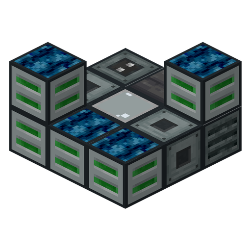
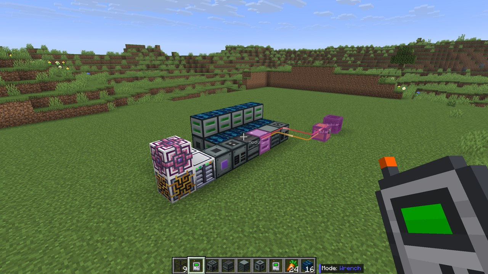
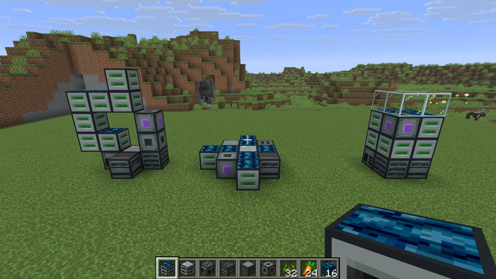

<p align="center">
  
</p>

<h3 align="center">Modular Planters</h3>

<p align="center">
  Build Agritech: Evolved planters into one multiblock with shared power, fertilizer and outputs
  <br>
  <br>
  <a href="wiki/"><strong>Read the guide</strong></a>
  <br>
  <br>
  <a href="https://github.com/julian-perge/ModularPlanters/issues/new?template=bug_report.yml">Report a bug</a>
  |
  <a href="https://github.com/julian-perge/ModularPlanters/issues/new?template=feature_request.yml">Request a feature</a>
  |
  <a href="CONTRIBUTING.md">Contributing</a>
  |
  <a href="DEVELOPMENT.md">Development</a>
</p>

---



## About

Modular Planters is an addon for Agritech: Evolved that replaces rows of Advanced Planters with one multiblock. A Modular Planter Block grows up to 64 seeds, and every Modular Planter Block in the multiblock shares one power supply, one fertilizer supply and one output store. One connection to the Modular Planter Core runs the whole multiblock.

It needs Minecraft 26.1.2, NeoForge 26.1.2.116 or newer, and Agritech: Evolved 2.2.0 or newer. AE2, Applied Flux, Jade, Oracle Index and Logistics Networks are optional.

The guide is in game through [Oracle Index](https://modrinth.com/mod/oracle-index), and its pages are in [`wiki/`](wiki/).



## Building from source

```
./gradlew build
```

The jar is written to `build/libs/`. [DEVELOPMENT.md](DEVELOPMENT.md) covers the dev runs, tests and optional dev mods.

## License

MIT, see [LICENSE.md](LICENSE.md).

The block textures are adapted from Agritech: Evolved's, which are MIT. Agritech: Evolved's copyright notice is in [LICENSE-ATE.md](LICENSE-ATE.md) and ships in the jar.
