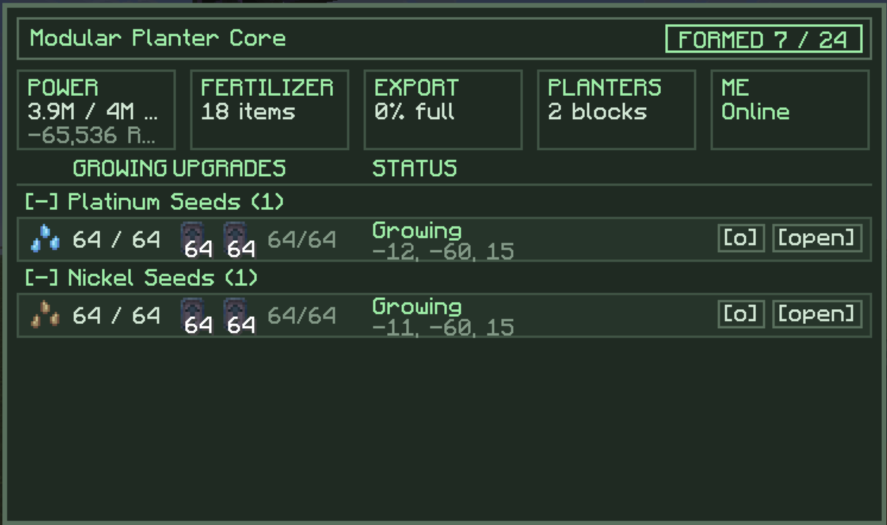
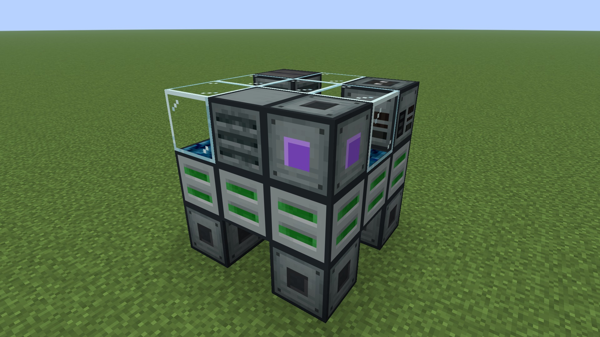

Modular Planters is an addon for Agritech: Evolved that replaces rows of Advanced Planters with one multiblock. A Modular Planter Block grows up to 64 seeds, and every Modular Planter Block in the multiblock shares one power supply, one fertilizer supply and one output store.

Needs Minecraft 26.1.2, NeoForge 26.1.2.116 or newer, and Agritech: Evolved 2.2.0 or newer. Optional: AE2, Applied Flux, Jade, Oracle Index and Logistics Networks.

## Features

- One connection to the Modular Planter Core runs power, fertilizer and outputs
- The Modular Planter Core's screen lists every Modular Planter Block's seed, upgrades and status
- A built-in cloche that needs no item
- An optional Modular Planter ME Block for AE2, with Applied Flux power
- Jade tooltips and an in-game guide through Oracle Index
- Datapack recipes and a server config

## Build it your way

Connect a Modular Planter Core to power, fertilizer, export and planter blocks in any shape, face to face, up to 24 parts. Modular Planter Frames fill the gaps.

## See every planter at once

The Modular Planter Core's screen lists every Modular Planter Block with its seed, how many seeds are growing, its upgrades and its status. Open any of them from there, even one buried inside the build.

## One connection runs it all

Energy and fertilizer go in through the Modular Planter Core, and harvests come out of it. One Logistics Networks node, cable or pipe on the core runs the whole multiblock.

<!-- shot: ln-node.png -->

## AE2 and Applied Flux

The Modular Planter ME Block sends harvests into your ME network and tops up fertilizer from it. With Applied Flux, it also keeps the power blocks full from the network's FE.

## Guide and Jade

The full guide is in game through Oracle Index. Jade shows whether a Modular Planter Core is formed and how many seeds each Modular Planter Block is growing.

<!-- shot: guide-page.png -->

## Credits

Block textures are adapted from Agritech: Evolved (MIT).
