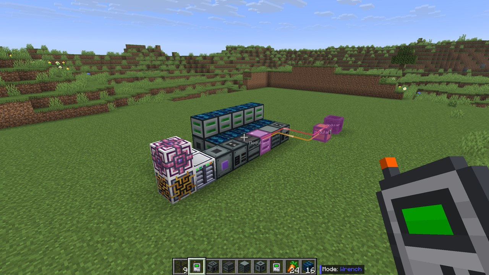
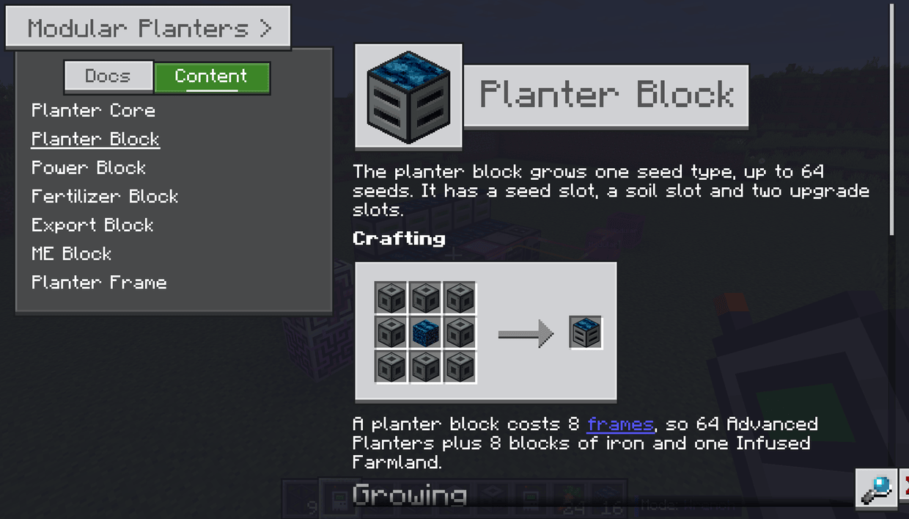
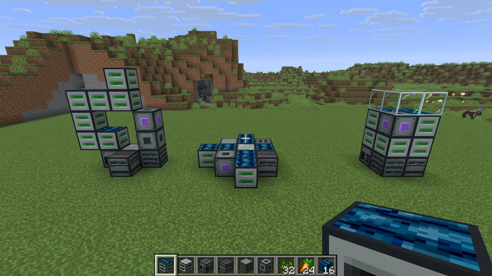
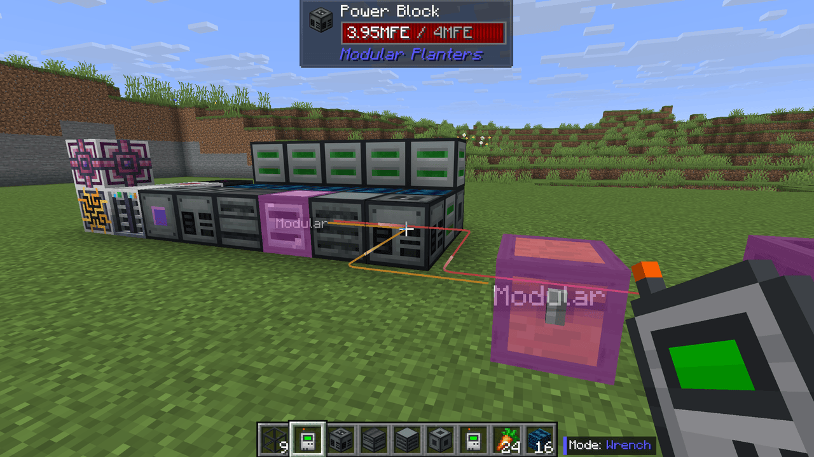

## About

I got tired of building rows and rows of Advanced Planters from Agritech: Evolved, so I made Modular Planters. It merges them into one multiblock. A **Planter Block** grows up to 64 seeds, and every planter block in the multiblock shares one power supply, one fertilizer supply and one output store.

- _Imagine placing 300+ `Advanced Planters`, all with `Logistics Network` nodes attached, and only having 16GB of RAM... The network route lines when holding the wrench were pretty though._

It works with these optional mods:

- **Jade**: tooltips for the core and every planter block
- **Oracle Index**: the full guide in game
- **Logistics Networks**: one node on the core runs the whole multiblock
- **AE2**: the ME Block sends harvests into your ME network and tops up fertilizer from it
- **Applied Flux**: the ME Block also keeps the power blocks full from the network's FE

## The in-game guide

With Oracle Index installed, the full guide is in game. It has a page for every block, plus pages on building, growing, the built-in cloche and the server config. If this page doesn't answer something, the guide probably does.

## Building a multiblock

Place a **Planter Core**, then connect parts to it face to face. Any shape works, as long as every part touches the core or another part. A multiblock needs at least one power block, one export block and one planter block, and it can have up to 24 parts by default.

### The parts

- **Planter Core**: forms the multiblock, opens the core screen and gives every planter block a built-in cloche. It stores nothing itself.
- **Planter Block**: grows one seed type, up to 64 seeds, with a soil slot and two upgrade slots.
- **Power Block**: holds 4M RF for the whole multiblock.
- **Fertilizer Block**: holds the fertilizer every planter block shares.
- **Export Block**: holds the harvests.
- **ME Block**: connects the multiblock to AE2. It only exists when AE2 is installed.
- **Planter Frame**: fills gaps, so you can build taller or wider shapes.

## How a Planter Block grows

A planter block works like a stack of Advanced Planters. Growth time, power and fertilizer come from ATE's own formulas and config, so a planter block with 64 growing seeds draws and produces what 64 Advanced Planters would. The number of seeds growing is the smaller of the seed count and the soil count, and each upgrade covers one seed.

The core gives every planter block a cloche for free, with ATE's cloche bonuses. When the export blocks fill up, the planter blocks wait, and nothing gets voided.

Jade shows whether a planter block is growing and how many of its seeds are.

## The Planter Core screen

Right-click the core to see every planter block in the multiblock, with its seed, how many seeds are growing, its upgrades and its status. You can open any planter block from there, even one buried in the middle of the build. The top row shows power, fertilizer, export space, the planter count and the ME status.

## Power, fertilizer and outputs

Energy and fertilizer go in through the core, and harvests come out of it, so the whole multiblock needs only one connection. Pipes, cables and nodes all work.

### Logistics Networks

One node on the core handles power in and items out. The node needs an upgrade sized to the farm, and the guide has a table of what each upgrade keeps up with.

### AE2 and Applied Flux

Add a **ME Block** and harvests go straight into your ME network. It also tops up the fertilizer blocks from ME with the fertilizer set in its filter. With Applied Flux, it keeps the power blocks full from the network's FE as well.

## Server config and datapacks

The recipes are datapack recipes, so packs can change them. The server config has the part cap, the power block buffer and how often the ME Block moves items. ATE's numbers are never copied into the config, they're read straight from ATE.

## Credits

- Block textures are adapted from [Agritech: Evolved](https://www.curseforge.com/minecraft/mc-mods/agritech-evolved) (MIT).
- The multiblock design follows [ModularBees](https://www.curseforge.com/minecraft/mc-mods/modular-bees):
  - A core that links its parts, wall blocks between them, and an ME block for AE2.
  - I didn't use any of the mods code, and I greatly appreciate the author for making the mod for people like me who's machines can't handle all the bees.
- The in-game guide is set up for [Oracle Index](https://www.curseforge.com/minecraft/mc-mods/oracle-index) the way [Oritech](https://www.curseforge.com/minecraft/mc-mods/oritech) sets up its own.
  - Why `Oracle` over `GuideME` or `Patchouli`?
    - `Patchouli`
      - The books have inconsistent font sizing and texture/mesh issues, making it difficult for me to read them.
      - It's way easier for me to just hold the `Option` key and get the guide without having to carry a book around that's hard to search.
    - `GuideME`
      - I mostly see this with `Applied Energistics 2`, and it's almost certainly my machine struggling with only 16GB of RAM, but initial loading or changing pages always ends up having a 2-3 second pause before switching.
- The core screen is modeled on the Node Table in the [Logistics Networks](https://www.curseforge.com/minecraft/mc-mods/logistics-network) `Computer`.
  - This is such an awesome mod, seriously. I take zero credit for the `Planter Core` screen design.
